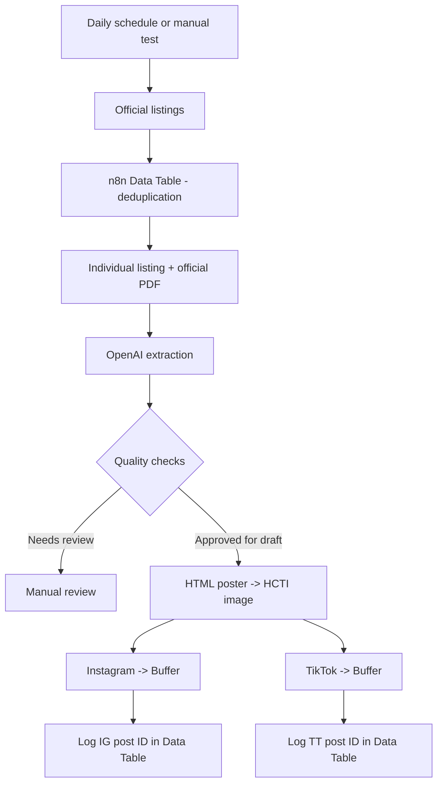

# Concours Maroc — AI Social Media Automation 🇲🇦

**n8n workflow for collecting official Moroccan public-sector recruitment announcements, verifying their details against PDF notices, and preparing Instagram/TikTok posts via Buffer.**

**Status:** functional MVP demonstrated with Instagram and TikTok Buffer drafts, image generation, and per-channel deduplication. The public workflow here is a **sanitized V4 reference template**, not a live export of the latest manually edited production instance.

## What it does

- Discovers public recruitment announcements from **emploi-public.ma**.
- Opens each announcement and identifies its official PDF notice.
- Uses **OpenAI Responses API** to extract institution, grade, vacancies, specialties, qualifications, dates, and conditions, including scanned documents when the model can read them.
- Cross-checks extracted facts against the individual listing; mismatches are routed to a **review queue** instead of being published.
- Generates an Arabic/French branded recruitment poster in HTML/CSS using **HTML/CSS to Image (HCTI)**.
- Sends a caption and media asset to **Buffer**, with separate Instagram and TikTok routes.
- Uses an **n8n Data Table** to avoid duplicate submissions on each channel independently.

## Architecture

## Stack

| Component | Technology |
| --- | --- |
| Orchestration | n8n (self-hosted) |
| Sources | Official public recruitment website and PDF notices |
| Information extraction | OpenAI API |
| Visual generation | HTML/CSS + HCTI |
| Social scheduling | Buffer GraphQL API |
| Idempotency | n8n Data Tables |
| Hosting during development | PikaPods |

## Import and configuration

1. Import [`workflow/concours-maroc-v4-template.json`](workflow/concours-maroc-v4-template.json) in n8n.
2. Create a Data Table named **concours_maroc_drafts** with text columns **source_url**, **instagram_draft_id**, **tiktok_draft_id**, and **statut**.
3. Assign credentials in the **OpenAI**, **HCTI**, and **Buffer** HTTP Request nodes. No API key is included in this repository.
4. In the `01 CONFIG - Editions minimales` Code node, replace **REPLACE_WITH_IG_CHANNEL_ID** and **REPLACE_WITH_TT_CHANNEL_ID** with your own Buffer channel IDs.
5. Keep `allowBufferDrafts: false` and `allowManualBufferDrafts: false` for the first local tests.
6. Test PDF extraction, quality checks and image output. Only enable Buffer drafts when results have been reviewed.
7. Connect and activate the Schedule Trigger **only after** testing the workflow, timezone, account publishing modes and deduplication.

> **This is a portfolio snapshot.** Some fixes made later in the live n8n UI (TikTok image sizing / publishing configuration) are not reflected in this original V4-based template. Export the latest live workflow to make this repository an exact operational backup.

## Safety and caveats

- AI extraction is fallible. A `COHERENT` label is a workflow-level check, **not** an authoritative verification of eligibility or recruitment terms.
- Prefer human review before posting time-sensitive or disputed public-sector recruitment information.
- TikTok and Instagram have different media constraints; a large HCTI image may be rejected by TikTok.
- Public media URLs must remain accessible when Buffer publishes the content.
- `saveToDraft: true` is intentionally retained in this public template; turning it off can enqueue content for automatic publication.
- Each candidate should verify qualifications, deadlines, and registration links in the **original official notice**.
- Never commit n8n credentials, API keys, exported execution data or private data.

## Future roadmap

- [ ] Platform-specific TikTok MP4 with properly licensed audio
- [ ] More reliable HTML-to-image and asset storage pipeline
- [ ] Operator dashboard for review decisions
- [ ] Alerts for failed jobs, expired media URLs and quota limits
- [ ] Per-channel publishing analytics

## About

Built as a practical AI automation project for sharing Moroccan public-sector recruitment opportunities. Independent informational project; not affiliated with the government or the official recruitment portal.